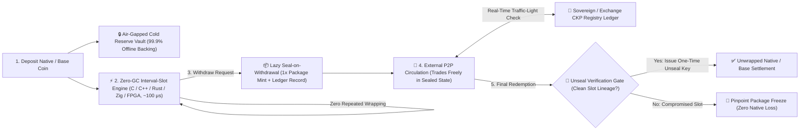

# 📦 CKP Theory (Crypto Kernel Packaging)

<p align="center">
  <strong>Sub-100μs Slot Lineage & Lazy Seal-on-Withdrawal Architecture Across General Cryptocurrencies and Native <code>$1</code> Stablecoins</strong><br>
  <em>An Open Architectural Thought Experiment by <a href="https://axnli.com">AXNli Inc.</a> (Systems for Data & AI)</em>
</p>

<p align="center">
  <a href="./README.md"></a>
  <a href="https://axnli.com"></a>
  <a href="#4-dual-scope--closing-note-from-all-coins-to-native-stablecoins"></a>
  <a href="./LICENSE"></a>
</p>

---

## 1. Transparent Attribution, Existing Prior Art & Incident Analysis

> [!NOTE]
> **Honest Disclaimer on Prior Art**  
> We did **not** invent the underlying cryptographic, custody, or token-compliance primitives discussed in this note. Every individual building block referenced below already exists across academic papers, Bitcoin/Ethereum improvement proposals, and institutional custody frameworks. **`CKP` (Crypto Kernel Packaging)** arose simply from reviewing those existing theories, analyzing why the **October 29, 2026 `~$6.3B` (~8.4 trillion KRW) Binance multi-chain wallet breach** ([public reporting](#surveyed-prior-art--references), Ref. 6) still occurred despite them, and asking how existing pieces might be rearranged into a cohesive defensive pipeline.

### 1.1 Why Exchange Hot Wallets Still Lose Billions

When a major centralized exchange suffers a multi-billion-dollar wallet drain, blockchain purists often argue: *"The blockchain ledger was not hacked; the exchange's signing key was compromised."* Technically true—yet architecturally incomplete. Two design choices conspire to turn a single server compromise into an irreversible catastrophe:

1. **The Omnibus Hot-Wallet Honeypot**: User deposits are swept into huge shared hot wallets so internal trades can settle off-chain in microseconds. On-chain, millions of users' funds are controlled by **one operational signing authority**, while per-unit ownership lineage disappears inside the commingled pool.
2. **Instant Irreversibility Without Custody Context**: The moment a compromised signing service broadcasts a valid signature, native L1 ledgers finalize the transfer within seconds—treating a `$6.3B` midnight drain identically to a `$5` coffee payment. Notably, during the October 2026 breach, roughly `$2.7B–$3.0B` was frozen *only* where centralized stablecoin issuers (`USDT`, `USDC`) or network security councils intervened, whereas raw permissionless L1 assets vanished into downstream swaps.

### 1.2 Survey of Existing Theories & Why Each Stalled Alone

Before sketching `CKP`, we surveyed six established proposals and industry architectures:

| Existing Theory / Standard | Core Mechanism | Why It Did Not Prevent Hot-Wallet Drains Alone |
| :--- | :--- | :--- |
| **Bitcoin `OP_VAULT` (`BIP-345`, James O'Beirne & Greg Sanders)** | Enforces mandatory on-chain withdrawal time-delays (e.g., 24–48h) with an offline recovery (`clawback`) key path. | Applying a 24h freeze to every retail withdrawal destroys instant exchange UX; never activated on Bitcoin and withdrawn in 2025 in favor of `OP_CHECKCONTRACTVERIFY` (`BIP-443`). |
| **Ethereum `ERC-7265` (Circuit Breaker, Draft Proposal)** | Trips an automated rate-limiter when protocol outflows exceed a threshold per time window. | Never finalized as an ERC; protects EVM smart-contract vaults, not multi-chain native omnibus hot wallets; skilled attackers drain below or around static thresholds. |
| **Stanford `ERC-20R` / `ERC-721R` (Wang, Wang & Boneh, 2022)** | Adds a post-transfer dispute window during which a quorum of decentralized judges can freeze and reverse thefts. | Breaks DeFi composability and creates severe innocent-third-party clawback dilemmas once stolen fungible tokens are swapped in 1 second on a DEX. |
| **Bitcoin `Statechains` (`Mercury Layer`, Ruben Somsen)** | Keeps coins fixed in discrete slots (`UTXOs`) and transfers off-chain key-share ownership rather than moving L1 coins. | Requires per-UTXO co-signing ceremonies unsuitable for sub-millisecond fractional order-book matching. |
| **Hybrid Low-Latency / Self-Custody Venues (`Cube` Exchange, `StarkEx`-based exchanges)** | Combines sub-millisecond off-chain matching (Cube advertises a ~200 μs engine) with MPC co-signed user vaults (Cube) or validity-proof L2 settlement with forced-withdrawal escape hatches (StarkWare's `StarkEx` scaling engine). | Requires migrating the entire retail base away from standard custodial accounts and loses post-withdrawal containment once raw L1 coins exit. |
| **Permissioned / Wrapped Standards (`ERC-3643` T-REX, MAS `PBM`, `cbBTC`)** | Embeds compliance registries, purpose-bound wrappers, or issuer blacklists directly into wrapped token contracts. | `ERC-3643` targets native security issuance; `cbBTC`/`USDC` use commingled omnibus backing without microsecond internal slot-lineage provenance. |

---

## 2. The `CKP` Architecture (Crypto Kernel Packaging)

**`CKP` (Crypto Kernel Packaging)** asks a simple engineering question:

> **What if coins remain standard outside, get indexed into sub-100μs lineage slots upon entering an exchange, are cryptographically "packaged" *only once* at the moment of withdrawal, circulate freely peer-to-peer while still packaged, and require ledger verification to obtain the final unseal key?**

Crucially, **because 24/7 instant withdrawals emit `CKP`-sealed packages rather than raw native coins, the exchange no longer needs to keep billions of dollars of raw assets in an internet-connected hot wallet.** `99.9%` of native backing reserves can stay permanently inside an **Air-Gapped Cold Vault**.



### 2.1 Four-Stage Operational Pipeline

1. **Stage 1 — Segregated Interval-Slot Ingestion (No Omnibus Mixing)**
   * When an asset enters the exchange, its backing value is vaulted offline while its logical representation is assigned a deterministic **Slot Range** $[a, b)$ inside an in-memory **Interval Tree** rather than dissolved into an anonymous scalar balance.
2. **Stage 2 — `0.0001s` (`100 μs`) Language-Agnostic In-Memory Lineage Matching**
   * During high-frequency trading inside the exchange, **no cryptographic packaging or on-chain transaction occurs**.
   * **Not tied to any specific language**: Implemented in any ultra-low-latency, zero-GC systems stack—such as **`C`, `C++`, `Rust`, `Zig`**, or even hardware-accelerated **`FPGA` / kernel-bypass** pipelines common in HFT engines—the matching engine splits, merges, and updates interval-slot pointers in `~100 μs` (`0.0001s`) or faster, recording an append-only directed acyclic lineage (`Slot Range | Prior Owner -> Current Owner | Trade Sequence`).
3. **Stage 3 — Lazy Packaging on Withdrawal (`Seal-on-Withdrawal`)**
   * Packaging is performed **lazily—once, only when a user withdraws**.
   * Instead of sweeping raw native coins out of an online hot wallet, the withdrawal gateway encapsulates the user's exact slot lineage commitment into a **`CKP` Sealed Package Token** and registers its package ID and lineage root on the **CKP Registry Ledger**.
4. **Stage 4 — Sealed External `P2P` Circulation & Gated Unsealing**
   * **Free External Circulation**: A `CKP`-sealed package behaves like a normal transferable token across external wallets and peer-to-peer (`P2P`) transfers—still wearing its protective seal.
   * **Stateful Unseal Gate**: Whenever a holder wishes to strip the package (`Unseal` / `Unwrap`) back into raw base settlement—or deposit it into another regulated venue—they submit an unseal request to the CKP Registry Ledger. If the underlying slot lineage is clean, the ledger logs the redemption and issues the cryptographic **Unseal Authorization Key (Signature)**; if the slot originated from an unauthorized server breach, unsealing is deterministically denied.

### 2.2 Formal Slot-Lineage & Unseal Invariant

Let the total custodied supply of an asset class be partitioned into half-open integer atomic-unit intervals $S_i = [\ell_i, r_i)$ with $\bigcup_i S_i = [0, M)$ and $S_i \cap S_j = \emptyset$ for $i \neq j$.

* **Internal Trade Transition (`~100 μs`, Zero Crypto Overhead)**:
  A trade of quantity $0 < \Delta \le r_i - \ell_i$ from seller $u$ to buyer $v$ at sequence $t$ performs an $O(\log N)$ interval update in memory (omitting the trailing remainder when $\Delta = r_i - \ell_i$):

$$
\big([\ell_i, r_i),\, u,\, h_i\big) \;\longrightarrow\;
\Big([\ell_i, \ell_i + \Delta),\, v,\, H(h_i \parallel u \parallel v \parallel t)\Big) \;\cup\;
\Big([\ell_i + \Delta, r_i),\, u,\, h_i\Big)
$$

  where $h_i$ is a fast incremental lineage digest (`BLAKE3`).

* **Lazy Withdrawal Seal**:
  Upon withdrawal of interval set $\mathcal{I}_w$ by user $v$, the gateway emits a sealed package $\mathcal{P}_{\text{id}} = \langle \text{id},\, \text{Root}(\mathcal{I}_w),\, \sigma_{\text{issuer}} \rangle$ while the raw asset remains untouched in cold storage.

* **Unseal Predicate**:
  Final unsealing of $\mathcal{P}_{\text{id}}$ succeeds if and only if:

$$
\mathrm{ValidUnseal}(\mathcal{P}_{\text{id}}, \pi_{\text{holder}}) \iff
\Big(\forall S_k \in \mathcal{I}_w : \mathrm{Status}_{\text{Ledger}}(S_k) = \mathtt{CLEAN}\Big) \;\land\; \mathrm{VerifySig}(\pi_{\text{holder}})
$$

### 2.3 Minimal Conceptual Reference Blueprint (Language-Agnostic; Illustrated in `Rust`)

> *Note: `CKP` is completely language-agnostic and can be built in `C`, `C++`, `Rust`, `Zig`, or hardware `FPGA` logic for even lower sub-microsecond latency. `Rust` is used below purely for concise readability.*

```rust
use std::collections::{BTreeMap, HashMap};

pub type UserId = u64;
pub type PackageId = u128;

#[derive(Clone, Copy, Debug, PartialEq, Eq)]
pub enum LineageStatus {
    Clean,
    FlaggedBreach,
}

#[derive(Clone, Debug)]
pub struct SlotSegment {
    pub start: u128,          // Inclusive atomic unit offset
    pub end: u128,            // Exclusive atomic unit offset
    pub owner: UserId,
    pub prev_owner: UserId,
    pub lineage_hash: u64,    // Incremental provenance digest
    pub status: LineageStatus,
}

#[derive(Clone, Debug)]
pub struct SealedPackage {
    pub package_id: PackageId,
    pub current_holder: UserId,
    pub segments: Vec<(u128, u128, u64)>, // (start, end, lineage_hash)
    pub unsealed: bool,
}

/// Conceptual CKP Engine: ~100us in-memory interval lineage + lazy withdrawal packaging.
pub struct CkpKernelEngine {
    slots: BTreeMap<u128, SlotSegment>,
    registry_ledger: HashMap<PackageId, SealedPackage>,
    compromised_ranges: Vec<(u128, u128)>,
    next_offset: u128,
    next_pkg_id: PackageId,
}

impl CkpKernelEngine {
    pub fn new() -> Self {
        Self {
            slots: BTreeMap::new(),
            registry_ledger: HashMap::new(),
            compromised_ranges: Vec::new(),
            next_offset: 0,
            next_pkg_id: 1,
        }
    }

    /// Stage 1: Ingest deposit into a dedicated non-overlapping interval slot [start, end).
    pub fn ingest_deposit(&mut self, amount: u128, owner: UserId) -> Option<u128> {
        if amount == 0 {
            return None;
        }
        let start = self.next_offset;
        let end = start.checked_add(amount)?;
        self.next_offset = end;
        let seed_hash = (start as u64).wrapping_mul(0x9E37_79B9_7F4A_7C15) ^ owner;
        self.slots.insert(
            start,
            SlotSegment {
                start,
                end,
                owner,
                prev_owner: owner,
                lineage_hash: seed_hash,
                status: LineageStatus::Clean,
            },
        );
        Some(start)
    }

    /// Stage 2: Sub-100us in-memory ownership transfer with interval splitting (zero wrapping).
    pub fn fast_internal_transfer(
        &mut self,
        slot_start: u128,
        amount: u128,
        buyer: UserId,
        seq: u64,
    ) -> bool {
        let Some(mut seg) = self.slots.remove(&slot_start) else { return false; };
        let available = seg.end - seg.start;
        if amount == 0 || amount > available || seg.status != LineageStatus::Clean {
            self.slots.insert(slot_start, seg);
            return false;
        }

        let mix = seg.lineage_hash.wrapping_mul(1099511628211) ^ buyer ^ seq;
        let transferred = SlotSegment {
            start: seg.start,
            end: seg.start + amount,
            owner: buyer,
            prev_owner: seg.owner,
            lineage_hash: mix,
            status: LineageStatus::Clean,
        };
        self.slots.insert(transferred.start, transferred);

        if amount < available {
            seg.start += amount;
            self.slots.insert(seg.start, seg);
        }
        true
    }

    /// Stage 3: Lazy Packaging — executed ONLY once upon withdrawal from the exchange.
    pub fn lazy_withdraw_package(&mut self, slot_start: u128, requester: UserId) -> Option<PackageId> {
        let seg = self.slots.get(&slot_start)?;
        if seg.owner != requester || seg.status != LineageStatus::Clean {
            return None;
        }
        let seg = self.slots.remove(&slot_start)?;
        let pkg_id = self.next_pkg_id;
        self.next_pkg_id += 1;

        let pkg = SealedPackage {
            package_id: pkg_id,
            current_holder: requester,
            segments: vec![(seg.start, seg.end, seg.lineage_hash)],
            unsealed: false,
        };
        self.registry_ledger.insert(pkg_id, pkg);
        Some(pkg_id)
    }

    /// Emergency Breach Hook: flags compromised slot intervals globally on the registry ledger.
    pub fn flag_compromised_range(&mut self, start: u128, end: u128) {
        if start < end {
            self.compromised_ranges.push((start, end));
        }
    }

    /// Real-time "Traffic-Light" status check before external P2P counterparties accept a package.
    pub fn query_traffic_light(&self, pkg_id: PackageId) -> LineageStatus {
        let Some(pkg) = self.registry_ledger.get(&pkg_id) else {
            return LineageStatus::FlaggedBreach;
        };
        for &(s, e, _) in &pkg.segments {
            if self.compromised_ranges.iter().any(|&(cs, ce)| s < ce && cs < e) {
                return LineageStatus::FlaggedBreach;
            }
        }
        LineageStatus::Clean
    }

    /// Stage 4a: External P2P transfer while remaining in the CKP-sealed state.
    pub fn transfer_sealed_p2p(&mut self, pkg_id: PackageId, from: UserId, to: UserId) -> bool {
        if self.query_traffic_light(pkg_id) != LineageStatus::Clean {
            return false; // Traffic-light blocks innocent P2P buyer from receiving tainted package
        }
        let Some(pkg) = self.registry_ledger.get_mut(&pkg_id) else { return false; };
        if pkg.unsealed || pkg.current_holder != from {
            return false;
        }
        pkg.current_holder = to;
        true
    }

    /// Stage 4b: Final Unseal Gate — verifies clean lineage and issues a one-time unseal authorization.
    pub fn request_unseal_key(&mut self, pkg_id: PackageId, holder: UserId) -> Result<u64, &'static str> {
        if self.query_traffic_light(pkg_id) != LineageStatus::Clean {
            return Err("DENIED: Compromised slot lineage detected; package frozen.");
        }
        let pkg = self.registry_ledger.get_mut(&pkg_id).ok_or("Unknown package")?;
        if pkg.unsealed || pkg.current_holder != holder {
            return Err("DENIED: Invalid holder or already unsealed.");
        }
        pkg.unsealed = true;
        // Conceptual token (in production: HSM/threshold Ed25519 signature over package_id || holder)
        Ok(pkg.segments[0].2 ^ (pkg_id as u64) ^ holder)
    }
}
```

---

## 3. Defense Model & Sovereign Standard Layer

Any realistic critique of `CKP` immediately raises three sharp edge cases. Here is how the defense and institutional layer addresses them:

### 3.1 Defending Innocent `P2P` Buyers ("Traffic-Light" Lineage Oracle)
* **Attack Vector**: Instead of attempting to unseal a stolen package directly (which the ledger would block), an attacker tries to sell the still-packaged token `P2P` at a discount to an innocent buyer for cash.
* **Defense**: Every `CKP` package carries its slot-lineage root. Wallet interfaces and DEX routers query a lightweight, zero-latency **Traffic-Light Status Oracle** (`GREEN = Clean`, `RED = Flagged Breach`) on the CKP Registry Ledger before signing any `P2P` swap. Once an exchange flags an unauthorized withdrawal batch, tainted packages turn `RED` globally and become non-transferable before innocent buyers can take the bag.

### 3.2 Defending Against Slot Fragmentation
* **Engineering Challenge**: Repeated fractional trades (`0.001` units) split slots into millions of tiny fragments.
* **Defense**: Adjacent intervals belonging to the same owner with clean status are periodically coalesced (`Interval Compaction`) into checkpointed Merkle lineage epochs, preserving `~100 μs` $O(\log N)$ lookup speed without unbounded RAM growth.

### 3.3 The Sovereign Licensing & Statutory Guarantee Layer
Two classic objections remain if every private exchange invents its own isolated wrapper:
1. **Liquidity Fragmentation**: `PKG-ExchangeA` and `PKG-ExchangeB` would trade at different discounts, recreating 19th-century wildcat banking notes.
2. **Operator Insolvency Risk**: What if the issuing exchange goes bankrupt or shuts down its registry ledger while sealed packages are circulating outside?

**Architectural Assumption (Sovereign Standard Layer)**:  
`CKP` intentionally assumes **state-licensed digital asset exchanges operating under a unified national clearing standard** (analogous to open-banking payment rails, sovereign reserve mandates, and statutory deposit/custody insurance minimums):
* **Unified National `CKP` Envelope**: All licensed domestic exchanges wrap withdrawals into a **single interoperable `CKP` standard** backed by a federated regulatory registry, preserving `1:1` fungibility across venues.
* **Statutory Reserve & Fallback Redemption**: Because licensed exchanges must maintain audited `1:1` air-gapped reserves and statutory capital guarantees under national supervision, if a single exchange ceases operation, the national clearing custodian steps in to verify clean lineage roots and honor unsealing—decoupling package survival from single-company bankruptcy.

---

## 4. Dual Scope & Closing Note: From All Coins to Native Stablecoins

While `CKP` applies across the entire digital-asset spectrum, **its architectural fit becomes dramatically sharper when moving from volatile cryptocurrencies to fiat-backed `$1` (and sovereign-currency) stablecoins.**

### 4.1 Dual Application Scope: General Coins vs. Native Stablecoins

| Dimension | Mode A: General Cryptocurrencies (`BTC`, `ETH`, `SOL`, etc.) | **Mode B (Primary Purpose): `$1` / Sovereign Stablecoins & RWAs** |
| :--- | :--- | :--- |
| **Underlying Backing Asset** | On-chain bearer L1 coins isolated inside **99.9% Air-Gapped Cold Vaults**. | **Physical cash reserves & short-term Treasury bills** locked in regulated bank vaults. |
| **Role of `CKP` Packaging** | **Protective Custody Wrapper** applied lazily upon exchange withdrawal to eliminate hot-wallet drains. | **Native Issuance Format Itself** — no physical underlying ever moves on-chain; the stablecoin *is* born as a `CKP` package. |
| **External Circulation** | Circulates `P2P` in packaged form; unseals back to raw L1 coin upon verified request. | Circulates globally across wallets, merchants, and `P2P` just like digital cash—carrying embedded slot provenance. |
| **Final Redemption (`Unseal`)** | Ledger verifies clean slot lineage -> releases native L1 coin from cold reserve gate. | Ledger records & verifies clean slot lineage -> wires **physical/bank fiat (`$1` / local currency)** to the redeemer's bank account. |
| **Trust Anchor** | State-licensed exchange custody & national clearing standard. | **Natively aligned with statutory law** (e.g., U.S. `GENIUS Act` & sovereign stablecoin frameworks requiring `100%` audited reserves). |

### 4.2 Why `CKP` Shines Brightest on `$1` Stablecoins ("Serial-Numbered Digital Banknotes")

With raw cryptocurrencies like Bitcoin, one might ask *"Why add an extra custody package around an existing bearer coin?"*—because raw Bitcoin can exist on-chain without any issuer.

**With `$1`-pegged stablecoins (and tokenized RWAs), that friction vanishes completely:**
1. **Zero "Double-Wrapping" Overhead**: Physical dollars and government bonds never travel over the internet anyway; they sit permanently inside audited bank vaults. Every stablecoin on earth is *already* a circulating digital claim receipt (`package`) backed by vaulted reserves.
2. **From Unnumbered Coins to Serial-Numbered Digital Banknotes**: Existing stablecoins (`USDT`, `USDC`) were designed like *unnumbered metal coins*—once an attacker steals them and mixes them into a pool, per-unit provenance blurs. By contrast, a `CKP`-native stablecoin acts like a **modern banknote stamped with deterministic serial-number intervals (`Slot Ranges`)**:
   * Inside exchanges, serial-number intervals change hands in `~100 μs` (`0.0001s`) in memory without mint/burn overhead.
   * Outside exchanges, users receive and trade **the exchange/issuer's `CKP` package itself** seamlessly in `P2P` commerce—never needing physical cash to move until final bank redemption.
   * To convert `CKP` stablecoins back into **actual bank fiat ("physical settlement")**, the holder simply records the redemption on the regulated ledger and receives settlement once slot cleanliness is verified.
   * Because future `$1` and local-currency stablecoins are issued by **state-licensed, reserve-audited institutions**, public trust in the redemption ledger is guaranteed by law—while stolen serial-number slots become instantly unredeemable anywhere in the world.

### 4.3 Enjoy It Lightly! (Author's Note)
> [!TIP]
> **A Note from the Author**  
> To be completely candid: **`CKP` is not a grand breakthrough, nor do we claim it is a flawless silver bullet.** Every piece inside it stands on the shoulders of existing computer science and custody research. It is simply a **fun architectural "What if?" thought experiment**—sparked by analyzing a massive exchange hack and imagining how `1:1` `$1`-style stablecoins and exchanges might work as serial-numbered packages in the years ahead.  
>  
> It is nothing overly grandiose, just an enjoyable idea to think through—so please read it, poke holes in it, and enjoy it purely for the fun of systems design!

---

## 5. Position Within the `AXNli CK` Architecture Series

At **[AXNli Inc.](https://axnli.com)**, **`CKP` (Crypto Kernel Packaging)** sits alongside our open architectural notes exploring deterministic safety, verification, and systems design:
* **[`CKN` (`CKN-Architecture`)](https://github.com/kokogo100/CKN-Architecture)** — Hippocampus-inspired fractal memory and contradiction-triggered (`A ≠ B`) active inquiry.
* **[`CKS` (`CKS-Architecture`)](https://github.com/kokogo100/CKS-Architecture)** — Dead-zone closed-loop token-time PID activation steering for SLMs.
* **[`CKU` (`CKU-Architecture`)](https://github.com/kokogo100/CKU-Architecture)** — Cache-to-Cache (`C2C`) neural unification of task-specific deletion masks on a shared backbone.
* **[`CKD` (`CKD-Architecture`)](https://github.com/kokogo100/CKD-Architecture)** — Air-gapped triadic verification and closed-loop knowledge distillation.
* **[`CKP` (`CKP-Architecture`, *This Note*)](https://github.com/kokogo100/CKP-Architecture)** — Sub-100μs slot lineage and lazy withdrawal packaging for post-hack containment in regulated digital assets.

---

## 6. References, Citation & Search Tags

### Surveyed Prior Art & References
1. **Stanford Reversible Tokens (`ERC-20R` / `ERC-721R`)**: Kaili Wang, Qinchen Wang, and Dan Boneh (2022). *"ERC-20R and ERC-721R: Reversible Transactions on Ethereum."* Stanford University (`arXiv:2208.00543`).
2. **Bitcoin Vaults (`OP_VAULT` / `BIP-345`)**: James O'Beirne and Greg Sanders (2023). *"BIP-345: `OP_VAULT`."* Bitcoin Improvement Proposals (withdrawn in 2025; superseded by `BIP-443` `OP_CHECKCONTRACTVERIFY`).
3. **DeFi Circuit Breakers (`ERC-7265`)**: Diyahir Campos, Blagoj Dimovski, Philippe Dumonet, and Meir Bank (2023). *"EIP-7265: Circuit Breaker."* Draft proposal, [ethereum/EIPs PR #7265](https://github.com/ethereum/EIPs/pull/7265) (closed without being merged).
4. **Bitcoin Statechains & Slot Transfers**: Ruben Somsen (2018–2020). *"Statechains: Non-custodial Off-chain Bitcoin Transfer"* (see [Bitcoin Optech: *Statechains*](https://bitcoinops.org/en/topics/statechains/)), and CommerceBlock's *Mercury Layer* blind-signing statechain implementation (2024).
5. **Regulated Wrappers & Purpose-Bound Money**: Monetary Authority of Singapore (MAS, June 2023), *"Purpose Bound Money (PBM) Technical Whitepaper"* (Project Orchid); and Joachim Lebrun, Tony Malghem, Kevin Thizy, Luc Falempin, and Adam Boudjemaa (2021), [*"ERC-3643: T-REX - Token for Regulated EXchanges"*](https://eips.ethereum.org/EIPS/eip-3643) (`Final` Ethereum Standard).
6. **October 2026 Binance Incident Reporting**: [CNBC (Oct 29, 2026)](https://www.cnbc.com/2026/10/29/circle-tether-freeze-funds-impacted-by-potential-binance-security-issue.html), [NPR (Oct 31, 2026)](https://www.npr.org/2026/10/31/nx-s1-6024426/binance-crypto-heist-cyber-criminals-north-korea), and [Wikipedia: *2026 Binance hack*](https://en.wikipedia.org/wiki/2026_Binance_hack). Figures cited in this note (`~$6.3B` stolen, `~$2.7B–$3.0B` frozen) follow these public reports.

### Citing This Thought Experiment
```bibtex
@misc{axnli2026ckp,
  title  = {CKP (Crypto Kernel Packaging): Sub-100us Slot Lineage and Lazy Seal-on-Withdrawal Architecture for Regulated Stablecoins and Exchanges},
  author = {AXNli Inc.},
  year   = {2026},
  note   = {Open Architectural Thought Experiment},
  url    = {https://github.com/kokogo100/CKP-Architecture}
}
```

### Search Tags & Topics
`#CKP` `#CryptoKernelPackaging` `#Stablecoin` `#StablecoinArchitecture` `#DigitalBanknotes` `#SerialNumberedMoney` `#ExchangeSecurity` `#HotWalletDefense` `#AirGappedCustody` `#ColdStorage` `#LazyPackaging` `#SealOnWithdrawal` `#SlotLineage` `#IntervalTree` `#UTXOLineage` `#LowLatencySystems` `#HighFrequencyTrading` `#MatchingEngine` `#PostHackContainment` `#TheftRecovery` `#ReversibleTransactions` `#PurposeBoundMoney` `#ERC3643` `#RWA` `#RealWorldAssets` `#STO` `#TokenizedDeposits` `#GENIUSAct` `#RegulatedCrypto` `#HybridExchange` `#BlockchainSecurity` `#DigitalAssetCustody` `#SystemsArchitecture` `#ThoughtExperiment` `#AXNli`

* **Originated by**: **[AXNli Inc.](https://axnli.com)**
* **License**: MIT License (© 2026 AXNli Inc.)
